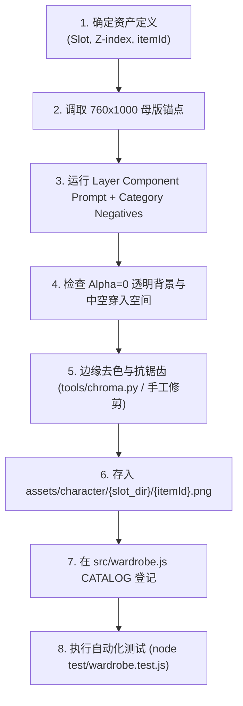

# Life 桌面数字生命立绘与分层换装资产生成规范（Layered Sprite Stacking Guide）

## 1. 核心定位：分层立绘叠放架构（Layered Sprite Stacking）

本规范用于指导 Life 桌面数字生命所有视觉图层的绘制与 AI 图像生成。程序采用 **760×1000 px 统一画布、透明 RGBA 32-bit PNG、固定全局锚点、分层立绘叠放（Layered Sprite Stacking）** 的渲染方案。

只要每一张素材严格遵循本规范：
- 渲染引擎无需单独针对单件素材调节 CSS offset、缩放或对齐位置；
- 新增服饰只需按目录放入并在 `src/wardrobe.js` 中登记；
- 各部件可以像专业 2D 换装游戏一样在同一身体基准上严密叠放，不产生穿模、双重肢体或面部漂移。

---

## 2. 核心原则：“完整角色生成”与“独立资产生成”的严格区别

在向 AI 绘图模型（如 Stable Diffusion、Midjourney、DALL-E 等）输入 Prompt 时，必须深刻认识到以下区别：

$$\mathbf{完整角色图\ Prompt \neq 独立分层资产\ Prompt}$$

- **完整角色图（Character Master Reference）**：用于确定画风基准、色彩体系、脸型、瞳色、发质、泪痣位置及初始人体比例。**仅用于视觉参照，禁止直接裁切或作为独立衣物图层！**
- **独立分层资产（Independent Layer Component）**：用于程序运行期叠放的独立身体、服装、发型或饰品图层。**严禁生成完整人体，必须仅生成该部件本身，其内部或背景完全中空透明！**

未来任何新增资产，必须先按以下矩阵确立工程属性，方可编写生成 Prompt：

$$\text{Asset Type} \longrightarrow \text{Slot} \longrightarrow \text{Layer Position} \longrightarrow \text{Anchor} \longrightarrow \text{Z-index} \longrightarrow \text{Negative Constraints} \longrightarrow \text{Prompt}$$

---

## 3. Schema 1：角色母本与身体核心（Body Base Prompt 规范）

### 3.1 Body Base 的职责
Body Base（基础身体层，如 `assets/character/base/base.png` 或 `body.png`）是数字生命的**稳定身份核心**：
- 它提供了稳定的骨骼高度、头身比、肩膀宽度、腰臀轮廓与站立基准线；
- **绝对不随换装、发型变化而发生任何比例漂移或锚点偏移**；
- 必须为无服装、无鞋、不带独立可拆卸发型的干净素体；
- 预留中性基础五官与脸型，供后续表情差分系统叠加。

### 3.2 技术规格
- **画布尺寸**：760×1000 px
- **色彩模式**：RGBA 32-bit（真正透明背景，Alpha=0）
- **姿态**：正面完全水平对称站立（front view, neutral standing pose），两臂自然垂下与躯干微分离，双脚平稳踏在固定水平基准线上，无任何动态透视倾斜。
- **构图**：全局居中（centered），头顶及左右保留充足呼吸余量（约占画布高度 75%~80%）。

### 3.3 Body Base 正向 Prompt 模板
```text
masterpiece, best quality, ultra-detailed, anime cel-shading, 1girl, chulan,
pale fair skin, slender graceful adult female proportions,
neutral standing pose, perfectly facing front, looking directly at viewer,
light blue-gray eyes, calm, curious and intelligent neutral expression, closed mouth,
single subtle beauty mark under left eye, fixed delicate face shape,
bald head OR skin-tight pale neutral hair cap, no loose hair,
completely bare body, naked base model, bare shoulders, bare arms, bare legs, bare feet,
arms slightly separated from torso, feet firmly standing on horizontal baseline,
clean lineart, consistent anime game sprite asset,
pure transparent background, 760x1000 canvas, centered composition.
```

### 3.4 Body Base 负向 Prompt 模板
```text
clothes, underwear, dress, shirt, skirt, pants, socks, shoes, boots,
long hair, loose hair, bangs, hair accessories, bow, ribbon,
action pose, dynamic pose, walking, running, sitting, tilted head, camera tilt, perspective foreshortening,
side view, three-quarter view, back view, crossed arms, crossed legs, hands in pockets,
blurry, lowres, bad anatomy, deformed limbs, extra fingers, extra hands, missing limbs,
background, indoor, outdoor, shadow on floor, drop shadow, white background, gray background, checkerboard pattern.
```

---

## 4. Schema 2：独立分层组件（Independent Layer Component Prompt 规范）

### 4.1 独立组件的硬性约束
所有服装（top、bottom、dress、outerwear）、鞋袜（socks、shoes）、独立发型（hair）与饰品（hairAccessory、accessory）必须满足：
1. **单一独立组件（Single Isolated Component）**：只生成该物件本身，严禁包含模特人体、人体轮廓、假人模特（Mannequin）或衣架。
2. **相同画布与锚点（Fixed 760×1000 Canvas）**：即使是一只小蝴蝶结或一双短袜，也必须输出在 **760×1000 px 画布** 的绝对正确空间位置上，与 Body Base 严格重合对齐。
3. **一致光照（Consistent Lighting）**：统一采用正前上方柔和赛璐珞光源（Upper-front soft lighting），避免部件叠放时光影方向矛盾。
4. **透明背景与完全中空（Transparent Interior Space）**：
   - **服装内部必须中空**：领口、袖口、下摆内部原本露出身体的部分必须是**完全透明的 Alpha=0 空间**，供 Body Base 的身体肌肤自然穿入显露。严禁模型在衣服内部绘制肉色皮肤、手臂截面或脖颈！

### 4.2 发型结构解耦约束（Back-Hair vs Front-Hair）
长发极易在叠放时发生层次穿模。严禁将所有长发合并为一个覆盖在所有服装最前方的庞大图层。
规范要求拆分两部分：
- **后发（Back Hair, Z-index 较低）**：位于身体与大部分衣物之后（`z < body` 或紧贴底模背后），承载后脑勺长发、垂至背部的披肩发梢。
- **前发/刘海（Front Hair / Bangs, Z-index 较高）**：位于面部五官与内层衣物之前，承载刘海、鬓角侧发。
- **发型款式可换、可处于无发素体形态**（v1.0 起 `hair` 槽位放开，不再标 `required`）：发型**不是**身份属性，**发色才是**——任何发型下都必须是银白、发尾淡冰蓝；无发时渲染干净素体，不得留头皮接缝或发际线残像素。

---

## 5. Negative Prompt（负向提示词体系）

### 5.1 全局通用 Layer Negative Prompt
生成任何独立分层图层时，**必须默认携带**以下全局排斥词：
```text
human body, skin, naked body, torso, chest, face, head, neck, collarbone,
hands, fingers, arms, legs, thighs, feet, toes, human silhouette,
mannequin, dress form, dummy, hanger, clothing rack, stand, display stand,
extra limbs, extra sleeves, extra legs, deformed shape,
skin showing through empty clothes, flesh tones, skin texture,
drop shadow, cast shadow, ambient occlusion shadow on background,
white background, gray background, black background, opaque background,
checkerboard pattern, faux transparency grid,
cropped edges, close-up, perspective distortion, isometric view.
```

### 5.2 类别专属 Negative Prompt 补充

#### (1) 上装与外套（Tops & Outerwear）
```text
neck, collarbone skin, cleavage, chest skin, belly, navel, bare shoulders,
arms inside sleeves, wrists, hands, waist skin, lower body, skirt, pants.
```

#### (2) 下装与短裙（Bottoms & Skirts）
```text
waist skin, belly button, legs inside skirt, thighs, knees, calves, underwear, upper body, shirt.
```

#### (3) 连衣裙（Dresses）
```text
bare skin inside neckline, bare arms, bare legs under hem, body contours drawn in skin tone, head, face, shoes.
```

#### (4) 袜子（Socks & Thigh-highs）
```text
feet, toes, toenails, legs, skin above socks, skin below socks, shoes, boots, sole of foot.
```

#### (5) 鞋靴（Shoes & Boots）
```text
legs, ankles, socks, bare feet, toes, skin, pants legs tucked in, ground plane, floor shadow.
```

#### (6) 发型（Hair Components）
```text
face, eyes, nose, mouth, ears, neck, shoulders, complete head, skull, body, clothes, hairpins not requested.
```

#### (7) 发饰与配饰（Hair Accessories & Accessories）
```text
hair, head, face, ear, neck, fingers, clothes, full character.
```

---

## 6. 新资产工业化生成工作流



### 6.1 生成 Prompt 标准撰写范式（示例：灰色宽松 T 恤）
```text
[Prompt]
isolated single clothing item, one oversized light gray t-shirt,
short sleeves, relaxed crew neckline, soft cotton fabric texture,
hollow interior, transparent opening for neck and arms,
strictly front view, perfectly centered on 760x1000 canvas,
anime cel-shading style, clean crisp lineart, matching upper-front light source,
pure transparent RGBA background, production sprite asset.

[Negative Prompt]
human body, neck, collarbone, arms, hands, torso, chest skin, skin texture,
mannequin, hanger, shadow, checkerboard background, white background, cropped.
```

---

## 7. 现有衣柜插槽体系与未来扩展架构

### 7.1 当前生产已实现的 9 大插槽（`src/wardrobe.js`）
当前渲染管线严格按照以下 Z 轴层级升序叠放（从下到上）：

| 序号 | 槽位 ID (`slot`) | 中文名称 | Z-index | 是否必选 (`required`) | 冲突与互斥规则 |
| :---: | :--- | :--- | :---: | :---: | :--- |
| 1 | `hair` | 发型 | 10 | false（v1.0 放开；身份由发色承载） | 可换款式，可无发 |
| 2 | `socks` | 袜子 | 20 | false | 可脱下 |
| 3 | `dress` | 连衣裙 | 30 | false | **与 top、bottom 强互斥** |
| 4 | `top` | 上装 | 31 | false | 与 dress 互斥 |
| 5 | `bottom` | 下装 | 32 | false | 与 dress 互斥 |
| 6 | `outerwear` | 外套 | 40 | false | 覆盖于上装/连衣裙之上 |
| 7 | `shoes` | 鞋子 | 45 | false | 可脱下 |
| 8 | `hairAccessory`| 发饰 | 50 | false | 默认 `black_bow_01`，可脱下 |
| 9 | `accessory` | 饰品 | 60 | false | 最外层挂件 |

### 7.2 架构审查与未来插槽预留（Architecture Compatibility Check）
本轮审查确认：**初澜现有插槽体系具备向更高级生命体表现扩展的弹性，且不阻止后续演进。**
未来规划的可平滑挂载插槽包括：
- `backHair` (Z=5，底模背后的长发层)
- `frontHair` (Z=15，前额刘海层)
- `eyes` (Z=8，眼部差分与视线追踪)
- `mouth` (Z=9，嘴型差分与语音对口型)
- `expression` (Z=9.5，面部综合情绪表情)

> **职责边界说明**：
> “初澜身体之外的视觉组件原则上可替换”并不等同于所有视觉元素都必须塞入 `wardrobe.js`。
> 身体骨骼、生命情绪差分与日常换装服饰保持清晰的职责解耦，有利于后续平滑接入表情控制器或动画状态机。

---

## 8. 资源质检清单（Quality Checklist）

在将生成的图片提交入库前，必须逐项通过以下验收门禁：

- [ ] **格式正确**：必须为真正 32-bit RGBA PNG 格式，严禁伪透明或 JPG 强转。
- [ ] **尺寸绝对一致**：必须严格为 **760×1000 px**，严禁拉伸或非标准比例。
- [ ] **Alpha 通道真实透明**：背景必须完全透明（Alpha=0），严禁保留 AI 生成的伪透明黑白棋盘格。
- [ ] **穿入空间中空**：服装领口、袖口、裤口内部必须中空透明，无多余皮肤色块或假人骨架。
- [ ] **无边缘污染**：高对比度放大检查边缘，无白边（White Fringe）、黑边或绿幕反光溢色。
- [ ] **锚点重合**：与 `assets/character/base/base.png` 叠加对比，肩膀、腰线、脚底基准线 100% 严密对齐。
- [ ] **命名规范**：文件名仅限小写字母、数字和下划线（如 `hoodie_blue_01.png`），并在 `src/wardrobe.js` 中完成登记。

---

## 9. 生成管线实战经验（像素预算瓶颈与二段式降级）

`black_bow_01`（黑色蝴蝶结发饰，2026-10 首刀试点）实测沉淀的管线级经验：

### 9.1 像素预算瓶颈（Pixel Budget Bottleneck）

768×1024 全身构图中，紧凑发饰仅占约 **50×60 px**。该尺寸下生成模型存在**形态与拓扑的二选一**：

| 产物 | 形态 | 拓扑 | 结果 |
| :---: | :--- | :--- | :--- |
| v2 | 结体+双翼分明 | 发丝穿插（需挖孔→换发型即撕裂） | 拓扑违规 |
| v4 | 不可辨识残段 | 实心压发、零穿插 | 形态不达标 |

**提示词层面无法兼得**（两轮独立校准证实）。发饰类生成必须走 §9.2 二段式，或直接采用 §9.3 正典直提。

### 9.2 二段式特写管线（B-1，供无正典真值的原创饰品使用）

```
全身出图（定绝对锚点） → 头部特写出图（发饰获得 300px 级细节）
→ 提取发饰 → 等比缩放对齐锚点盒 → 760×1000 满幅切片
```

- 机械流程已验证跑通；但生成件质感/完整度通常**低于正典母本**（实测：扁平色块、缺垂带、无缎面材质）。
- **降级判据**：贴合度或质感受限时，无缝降级为 §9.3 正典直提。

### 9.3 正典直提优先原则（Canonical-First）

当 `assets/character/base/base_legacy_full.png` 等正典母本中存在该饰品时，**直接从母本提取**（画工、材质、正典暗纹 100% 保真，如蝴蝶结的银十字吊坠）：

- 母本自带 alpha 通道：`alpha > 128 × 亮度阈值` 双约束 + 区域生长，即可干净分离饰品与发丝/背景；
- **必须先按 alpha 过滤再做亮度分析**（透明区残留 RGB 是暗色垃圾，会污染连通域分析）；
- 提取后做连通域清洗（只保留饰品本体，剔除误卷入的发根阴影碎片）。

### 9.4 发饰切片拓扑铁律（Z=50）

- `hairAccessory`（z=50）压在发型（z=10）之上，物理本质是"别在发丝表面的发夹"：切片必须是 **100% 连续不透明实体，严禁发丝穿插孔洞**（孔洞透出的是另一套发型像素，换发型即撕裂）。
- 发丝仅允许压在饰品**外缘**（原画层叠感），不进入本体。
- **接触阴影不烘焙进图层**（其余区域 Alpha 必须严格为 0）；佩戴投影由渲染层对 `hairAccessory` 加 `drop-shadow` 滤镜解决。

---

## 10. 发型图层制作实战规范与三大正规管线（Hair Layer Standards）

发型（`slot: hair`, `z=10`）是角色的核心身份层，直接贴合面部与颅骨。2026-10 在 `silver_ponytail_01`（银发高马尾）实装攻坚中沉淀的工艺规范与红线纪律如下：

### 10.1 避坑教训：为什么"无头悬空假发片（Floating Wig）"不可行

试图通过提示词在虚空中生成"悬浮在纯黑背景上的空心假发套"已证实存在严重的结构性缺陷：

1. **解剖学参考缺失导致的比例失控**：扩散模型在没有真实面部与骨骼参考时，无法感知真实的头脸比。实测提示词若不强调发量，AI 仅画侧发导致左侧大面积露头皮（地中海光头）；若加权强调发量（如 `voluminous crown:1.4`），模型则会将颅顶膨胀为正常脸高 3.6 倍的实心蘑菇球，戴上后完全遮盖眉眼与鼻梁。
2. **构图失控与尾梢截断**：未包含身体缩放参考时，模型易将长发/马尾画出画面下边缘，导致发尾呈平切断茬，丢失自然的锥形收尖。
3. **结论**：**严禁采用"无头纯假发套"作为长发、马尾等复杂发型的生成方式**。

### 10.2 正规管线一：母本骨架嫁接法（Transplant & Restyle，已验证最佳）

当现有发型（如 `assets/character/hair/silver_wavy_01.png`）已与 `base.png` 形成 100% 吻合的发际线、前额空气刘海与颅顶弧度时，推荐采用模块化嫁接法：

- **保留前额与颅顶**：继承母本发型的完美前部图层，确保脸部完全露出、发际线 0 露肉、耳际 0 穿模；
- **裁切披散长发**：将母本背后的披肩散发按分界线精准修剪；
- **发辫部件缝合**：通过特写生成独立的精致马尾/发辫组件，等比缩放并锚定缝合至后脑侧上方；
- **优势**：成型速度快（10分钟级）、画风材质 100% 保持正典一致、零贴合翻车风险。

### 10.3 正规管线二：ControlNet 骨架约束图生图（全新发型推荐）

当需要创作与现有发型完全不同的全新发型（如短发、齐刘海波波头、双马尾等）：

- **头骨骨架强约束**：以 `base.png` 的头部轮廓线稿（Canny / Lineart）作为 ControlNet 约束条件送入 ComfyUI；
- **带人出图（保证比例）**：生成包含完整头脸的角色全身/半身图，借助面部与五官确保头型立体结构与发量自然可信；
- **素体差分扣除**：利用 `base.png` 已知的像素几何蒙版剔除皮肤与衣物，只保留包裹在素体外缘的发丝图层。

### 10.4 正规管线三：前后发分层架构演进（Front Hair + Back Hair）

二次元换装与 Live2D 业界的标准做法是将发型解耦为两个独立 Z 序图层：

1. **后发层（Back Hair，`z=5`，位于身体身后）**：承载后脑勺底发、双马尾、长马尾下摆或披肩发，背后整图铺设，**完全无需开窗镂空**；
2. **前发层（Front Hair，`z=10`，位于身体身前）**：仅承载前额刘海与两鬓发丝。

素体的脸部与身躯自然夹在前发与后发之间，从架构上彻底根除"单一发型图层掏空心脸洞"导致的边缘撕裂与光晕问题。
