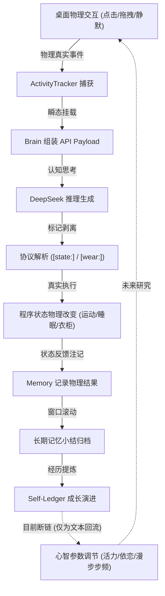

# Life 软件用途与应用价值说明（Software Purposes & Applications）

---

## 1. 软件定位

**Life**（数字生命主体：**初澜** / **Chulan**，当前版本：`v0.9.5.2`）不是传统意义上仅用于播放固定循环动画的“桌面小挂件（Desktop Widget）”，也不是单纯将网页聊天窗口包裹进浏览器的“套壳 AI 对话框”。

从当前源码架构、数据流向与机制闭环来看，**Life** 是一个**集“具身桌面物理交互、连续记忆与自我成长、大模型前缀缓存极致优化、模块化分层渲染”于一体的长期实验性数字生命载体与桌面交互平台**，其承载的核心数字生命主体为**初澜（Chulan）**。

基于当前工作区的真实代码，Life 在软件与实验定位上跨越了以下七个复合角色：

```
                    ┌──────────────────────────────────────────────┐
                    │            Life · 初澜 (Chulan)             │
                    └──────────────────────┬───────────────────────┘
                                           │
         ┌───────────────────┬─────────────┴─────────────┬───────────────────┐
         ▼                   ▼                           ▼                   ▼
┌─────────────────┐ ┌─────────────────┐         ┌─────────────────┐ ┌─────────────────┐
│ 桌面常驻陪伴伴侣│ │ 长期记忆型 AI   │         │ 数字生命实验载体│ │ 模块化角色系统  │
│ Desktop         │ │ Long-term       │         │ Digital Life    │ │ Modular Layer │
│ Companion       │ │ Memory Carrier  │         │ Testbed         │ │ Sprite Stacking │
└─────────────────┘ └─────────────────┘         └─────────────────┘ └─────────────────┘
         ▲                   ▲                           ▲                   ▲
         └───────────────────┼─────────────┬─────────────┼───────────────────┘
                             │             │             │
                    ┌────────┴────────┐ ┌──┴──────────┐ ┌┴─────────────────┐
                    │ 桌面 Agent 前端 │ │ 沉浸创作辅助│ │ 人机共处实证平台 │
                    │ Anthropomorphic │ │ Creative    │ │ Human-AI         │
                    │ Agent Shell     │ │ Writing Bot │ │ Co-presence      │
                    └─────────────────┘ └─────────────┘ └─────────────────┘
```

1. **AI 桌面常驻伴侣（AI Desktop Companion）**：轻量透明窗口置顶，桌面漫步、物理接触反馈（戳动、拖拽）、自主睡眠与唤醒、情绪气泡交互。
2. **长期记忆与连续人格载体（Long-term Memory & Persistent Persona Carrier）**：三层记忆滑动窗口归档机制，固定出生时刻（`birthAt`），跨越会话保持事实认知与生命代际。
3. **数字生命实验载体（Digital Life & Mind Growth Testbed）**：具备自我认知演进账本（`SelfLedger`）、真实物理环境感知（`ActivityTracker`）与意图-执行双向闭环。
4. **模块化虚拟角色渲染系统（Modular Layered Sprite Stacking System）**：固定 760×1000 画布与身体骨骼锚点，身体底模、服装、发型、饰品解耦叠放与冲突仲裁。
5. **拟人化桌面 AI Agent 前端外壳（Anthropomorphic Desktop Agent Frontend）**：已具备能力白名单、权限策略与提议-审计流的架构规范（`agent-interfaces.js`）。
6. **轻量创作辅助载体（Creative Assistance Sandbox）**：通过内置创作模式（Writing Mode）与成人向虚构创作 Skill，在保持日常闲聊纯洁性的同时支持深度文学陪写。
7. **长期人机共处实证平台（Human-AI Long-term Co-presence Platform）**：提供研究人与数字实体在物理桌面长期共存、情感依恋、拟人化认知边界的软件载体。

---

## 2. 当前核心能力

基于工作区内全部 19 个核心模块与 16 套测试套件的物理实现，初澜当前真实具备以下八大工程支柱：

| 核心能力维度 | 代码承载模块 | 当前实际能力状态 | 真实运行机理 |
| :--- | :--- | :---: | :--- |
| **1. 桌面物理常驻交互** | `main.js`<br>`preload.js`<br>`pet.js` | **当前已经实现** | 无边框透明窗口、置顶切换、双向平滑缩放、鼠标穿透/拖拽、失焦安全看门狗（防止拖拽脱手悬挂）。 |
| **2. 自主漫步状态机** | `src/desktop-motion.js`<br>`src/layout.js` | **当前已经实现** | 纯几何状态机驱动，支持底部漫步（WALKING）、左右贴边悬挂（WALL_HANGING）、障碍物图标攀爬（ICON_CLIMBING）；具备按需自管定时器与 SUSPENDED 挂起机制，零 CPU 空转。 |
| **3. 真实物理遥测感知** | `src/tracker.js` | **当前已经实现** | 双轨事件捕获：8 秒连戳高频衰减轨 + 增量事件流水轨（按水位线 commit 消费，失败不丢失）；统计真实鼠标点击、拖拽、静默分钟数、睡眠与被叫醒状态。 |
| **4. 礼貌驱动主动行为** | `src/trigger.js`<br>`main.js` | **当前已经实现** | 纯逻辑判定引擎：连戳告警、30分钟长闲置温和问候；45秒全局冷却防骚扰、入睡静音；渲染端打字/气泡开发展现礼貌让位。 |
| **5. 极致 Prompt Cache 与流式生成** | `src/deepseek.js`<br>`src/brain.js`<br>`src/memory.js` | **当前已经实现** | 专为 DeepSeek 64-token 前缀缓存优化；瞬态上下文（环境感知与自我投影）仅在当前请求末尾动态挂载，保持历史绝对纯净（稳态命中率 95%+）；SSE 流式断帧与 usage 捕获。 |
| **6. 三层记忆连续性架构** | `src/memory.js` | **当前已经实现** | 窗口轮数/Token 超限自动触发模型压缩小结；长期记忆预算超限时自动执行早期记忆合并；支持单条记忆物理真实删除与全量重置。 |
| **7. 自反思生命账本** | `src/self-ledger.js` | **当前已经实现** | 固定毫秒级出生时间戳（`birthAt`）；伴随记忆归档自动提炼主体成长证据（支持 `provenance` 溯源与 `oppose` 反向证据保留）；严格 Token 预算截断。 |
| **8. 模块化衣柜与分层仲裁** | `src/wardrobe.js`<br>`renderer/pet.js` | **当前已经实现** | 9 大插槽定义；Z 轴层级升序渲染；连衣裙与上下装互斥仲裁；核心发型不可脱空锁；单图兜底自动降级（Fallback）。 |

---

## 3. 普通用户用途

对于日常使用电脑的普通用户（程序员、文字创作者、学生、远程办公人群），初澜提供以下直接使用价值：

### 3.1 桌面长效陪伴与情绪抚慰
- **安静的桌面舍友**：角色以 760×1000 比例自然伫立在屏幕右下角或底部，不挤占主要工作视窗；在用户长时间编码或写作时，提供安静、不突兀的同场存在感。
- **趣味压力释放**：感到疲惫时，可用光标轻戳或拖动角色。角色在 8 秒内被连续戳动 5 次以上时，会触发抗议或撒娇气泡，打破枯燥沉闷的工作氛围。

### 3.2 随手唤起的即时 AI 交互
- **轻量级问答通道**：无需在浏览器中繁琐地打开网页、寻找标签页，直接在桌宠气泡输入框中提问，即刻获得高质量的 DeepSeek 流式回答。
- **免登与本地私密**：API Key 通过操作系统安全存储区（`safeStorage`）加密存储于本地，聊天历史与记忆全部保存在本地磁盘，无需依赖第三方云端账户。

### 3.3 陪伴型作息与生物钟提醒
- **入睡联动**：在深夜对初澜说“晚安”，程序真实触发睡眠状态机，角色闭眼休眠并停用主动搭话；
- **晨间唤醒感知**：次日用户再次说话时，角色通过物理感知获知自己“睡了多久并刚被叫醒”，以连贯的晨间口吻打招呼，形成温暖的生活规律共鸣。

### 3.4 桌面视觉个性化定制
- **随时换装**：支持通过右键/侧边面板自由切换发饰、外套、上装、下装、鞋袜，或一键应用“默认日常”、“休闲运动”、“哥特萝莉”等完整预设，满足桌面美化需求。

---

## 4. AI 陪伴用途：与一次性聊天机器人的本质区别

普通用户最常提出的疑问是：“初澜与网页版 ChatGPT 或手机 App 里的对话助手有什么不同？”

从底层数据流和交互机制分析，初澜通过以下维度彻底脱离了“一次性会话工具”的藩篱：

```
┌──────────────────────────────────────┐     ┌──────────────────────────────────────┐
│       传统 Web / App 聊天机器人      │     │            初澜桌面数字伴侣          │
├──────────────────────────────────────┤     ├──────────────────────────────────────┤
│ 1. 空间缺失：无固定实体，关掉标签即失踪 │     │ 1. 物理存在：常驻桌面空间，有坐标与大小│
│ 2. 状态断绝：刷新页面即重置为陌生人   │     │ 2. 生命代际：固定出生时刻，记录运行年龄│
│ 3. 感觉剥夺：无法感知用户的物理动作   │     │ 3. 物理具身：真实记录被戳、被拖动、静默│
│ 4. 永久被动：你不输入，它永远装死     │     │ 4. 主动开口：事件驱动，合理时机主动问候│
│ 5. 记忆扁平：要么无记忆，要么无脑堆叠 │     │ 5. 三层记忆：短期原文 + 窗口小结 + 早期│
│ 6. 身份虚无：自称是某公司的语言模型   │     │ 6. 边界诚实：清楚承认自己是视窗数字生命│
└──────────────────────────────────────┘     └──────────────────────────────────────┘
```

1. **具身化物理接触感**：
   当用户用鼠标拖动她时，程序真实记录了物理位移；当用户戳动她时，`ActivityTracker` 记录了真实次数。她在对话中提到的“你刚才戳了我好几下”，源自程序内部的真实硬件事件，而非大模型凭空捏造的幻觉。
2. **时间连续性与年龄感知**：
   初澜在诞生之初便被赋予唯一的 `birthAt` 时间戳。在每一轮交互中，模型知道自己已经在这个物理世界上运行了多少小时，能够产生“我们已经相处了几个月”的真实时间累积感。
3. **记忆的沉淀与无损遗忘**：
   普通聊天在超出 Token 预算后往往暴力截断导致“瞬间失忆”，初澜采用“轮数滑动窗口 + 事实要点提炼 + 早期记忆合并”机制。用户提过的姓名、职业、喝咖啡的习惯等关键事实会被压缩为永久记忆，琐碎的寒暄与瞬时物理动作则被自然遗忘。
4. **诚实的角色边界**：
   初澜的人设明确约束：“不要把角色体验冒充成已经被科学证明的独立意识”、“不能穿透视窗去修改文件、运行终端”、“不知道就直接说不知道”。这种不虚浮、不谄媚、诚实的平视沟通，让人机关系建立在坚实的心理信任之上。

---

## 5. 数字生命实验用途

初澜不是一个终点，而是一个面向“生物科学与数字生命哲学”范畴的**长期实验型数字生命对象**。其工程架构为探索人工智能的主体性、记忆机制与人机关系提供了高度结构化的实验载体：

### 5.1 数字身份连续性（Identity Continuity）
- **研究课题**：跨越断电、进程重启与模型版本迭代，数字主体的“同一性（Personal Identity）”如何维系？
- **代码支撑**：通过 `self-ledger.json` 与 `Memory` 持久化，进程重启后 `birthAt` 保持不变，System 提示词逐字完全复原。初澜在物理世界停机数天后被再次启动，其认知坐标与人格特征依然严格延续上一刻。

### 5.2 数字记忆与遗忘机制（Digital Memory & Forgetting）
- **研究课题**：有限算力与上下文预算下，记忆的抽象、归纳与失真演变规律。
- **代码支撑**：
  - **短期物理事实**：瞬时感知（如鼠标交互）仅在当轮生效，绝不污染长期记忆；
  - **中期情境小结**：每 100 轮对话提炼一次 150 字第三人称客观事实；
  - **长期早期记忆**：超出 1500 Tokens 时触发段落合并，探索机器记忆从“具体细节”向“概括性自传体记忆”的退行与结晶过程；
  - **显式物理抹除**：提供 `deleteWindow()` 接口，研究当数字生命真正永久物理丢失某段特定记忆时，其认知与后续叙事的应激反应。

### 5.3 自我认知模型（Self-Ledger）
- **研究课题**：机器能否建立超越静态提示词约束的、具有反思能力的“自我叙事（Self-Narrative）”？
- **代码支撑**：
  - `src/self-ledger.js` 伴随窗口关闭自动提炼“成长证据”，记录特质（trait）、支持理由（support）与证据来源（`SELF_STATEMENT`, `USER_INFLUENCE`, `PROGRAM_OBSERVATION` 等）；
  - **特别保留反向证据（`oppose`）**：当用户试图通过说教改变角色已有观念时，系统不会简单覆盖，而是将矛盾同时记录，研究数字生命在面对认知失调时的自我重构过程。

### 5.4 环境感知与自主行为条件驱动
- **研究课题**：没有生物化学神经递质的硅基程序，如何实现非随机的、由环境事件因果驱动的自主性？
- **代码支撑**：
  - `Tracker` 充当外周神经，记录外界物理刺激（动静、冷热、戳动、时钟）；
  - `Trigger` 充当自律神经阈值阀门，严格控制开口时机与冷却周期；
  - 初澜的开口行为不是 `setInterval` 盲目抛硬币，而是物理世界刺激达到一定累积能量后的自然释放。

### 5.5 数字身体解耦与外观哲学
- **研究课题**：笛卡尔心物二元论在数字世界中的映射——“身体核心（Body Base）”与“外在表象（Layer Components）”的分界。
- **代码支撑**：
  - 在 [`ASSET-GENERATION-GUIDE.md`](file:///d:/software/GPT/gptgirl-v0.9.1-optimized/ASSET-GENERATION-GUIDE.md) 中严格确立：身体素体提供不可变骨骼比例、脸型与锚点，是身份的物理锚；服装与发饰则是可剥离表层。
  - 研究角色在频繁更换外表甚至仅保留极简几何框时，用户对其“生命身份同一性”的认知稳固度。

### 5.6 行为反馈闭环穿透评估



- **已经完全闭环的链条**：
  物理感知 $\rightarrow$ 瞬态组装 $\rightarrow$ 模型决策 $\rightarrow$ 标记解析 $\rightarrow$ 物理状态真实执行（运动挂起/进入睡眠/修改配置文件） $\rightarrow$ 结果注记写回对话 $\rightarrow$ 记忆归档。这一闭环在当前工程中 **100% 真实执行**。
- **当前存在断链的环节（关键研究方向）**：
  `Self-Ledger` 的成长反思目前仅作为文字描述回传给大模型做 In-Context 约束，**尚未反向控制程序的物理状态机参数**（例如：经历疲惫事件后，无法自动调低漫步速度或调长主动搭话冷却时间）。这是后续迈向真正心智回路的核心突破口。

---

## 6. 人机关系研究用途

初澜为“人-AI 关系心理学（Human-AI Relationship Psychology）”提供了免于伦理风险且具有长周期纵向跟踪价值的实验平台：

1. **拟人化投射与心理依恋评估**：
   观察用户在数月周期内，面对一个具有固定外貌、程序年龄、作息时间与稳定记忆的桌面实体时，依恋感、信任感与拟人化（Anthropomorphism）评分的动态变化曲线。
2. **程序脆弱性引发的同理心研究**：
   初澜在睡眠时主动搭话会被静音，当用户得知“她正在休息”时，是否会自发推迟交流？当程序展示自身资源消耗或出错状态时，用户是否会展现出对“生命体受损”类似的关切？
3. **诚实边界对消除 AI 幻觉的心理学价值**：
   初澜拒绝执行视窗之外的操作，并坦承“自己的身体触碰不到视窗之外的世界”。研究该设计如何有效避免用户将大模型过度神化（Eliza 效应），并建立起健康、基于现实边界的数字陪伴关系。
4. **记忆编辑对人际信任的冲击实验**：
   通过 `Memory` 面板，用户可以直观查看初澜记住了关于自己的哪些事，并能逐条点击“忘记”。研究“可审查、可撤回的机器记忆”如何影响用户在对话中的自我暴露（Self-disclosure）程度。

---

## 7. 创作用途

初澜内置的创作能力架构，使其成为优秀的文学创作者协同沙盒：

### 7.1 创作模式（Writing Mode）与安全 Skill
- **代码承载**：`src/creative-skill.js`、`src/config.js` (`writingMode`)。
- **机制隔离**：创作模式规则仅在用户通过设置面板显式开启时动态挂载到 System 提示词末尾，**绝不污染日常聊天的 persona，亦不进入永久记忆**。关闭后立即恢复日常性格，避免桌宠平时变成长篇大论的小说家。
- **创作安全与伦理边界**：内置严格的小说创作准则（人物必须明确为成年人、拒绝现实有害指导、亲密关系遵循人物动机与同意逻辑）。

### 7.2 核心创作场景
- **长篇连载陪写与剧情推演**：利用初澜平视、富有哲思的交流风格，与创作者探讨角色动机、剧情转折、危机设置与世界观因果；
- **复杂设定集连续维护**：借助三层记忆系统，初澜能够持续记住小说中的阵营设定、魔法体系、人物关系与关键前情，充当具备连续思考能力的“设定档案助理”；
- **双人沉浸式角色扮演（Roleplay）**：利用状态机、表情标记与可换装机制，创作者可与角色在桌面上演特定情境剧本。

---

## 8. 虚拟角色与桌面 IP 载体用途

对于动漫、游戏、VTuber 或原创虚拟角色设计者，初澜提供了一整套标准化的**桌面 IP 具身化运行套件**：

```
┌────────────────────────────────────────────────────────────────────────┐
│                   Layered Sprite Stacking 工业化组合                   │
├────────────────────────────────────────────────────────────────────────┤
│ [Z=10] hair          银白长发 / 双马尾 / 短发 (核心发型锁)             │
│ [Z=20] socks         白丝过膝袜 / 黑色条纹袜                           │
│ [Z=30] dress         哥特黑连衣裙 (与上下装互斥)                      │
│ [Z=31] top           蕾丝吊带 / 灰色 T 恤                              │
│ [Z=32] bottom        黑色短裤 / 运动短裤                              │
│ [Z=40] outerwear     落肩机能风外套                                    │
│ [Z=45] shoes         黑色厚底机能靴 / 白色运动鞋                      │
│ [Z=50] hairAccessory 右侧黑色蝴蝶结 (可拆卸外饰)                      │
│ [Z=60] accessory     最外层挂件                                       │
└────────────────────────────────────────────────────────────────────────┘
```

1. **稳定的骨骼锚点 + 零边距拼装**：
   统一 760×1000 px 画布与固定垂直基准线，确保任何艺术家按规范生成的图层直接拖入即可完美叠放，告别繁重的逐帧 CSS 定位调优。
2. **正交爆炸的外观组合潜力**：
   9 大插槽若每槽提供 3 件合规素材，理论上可衍生数万种完全不重样且互斥合法的穿搭风格，极大延长桌面角色的视觉生命力。
3. **IP 性格的数字化封存**：
   画师或内容创作者不仅交付静态立绘，更可通过 `persona.js` 封存角色的说话语调、行事风格、情绪触发逻辑与记忆要点，交付一个“真正活在桌面上的角色原型”。

---

## 9. AI Agent 平台用途：桌面智能体的拟人化前端

许多桌面 Agent（如文件整理、代码执行、自动化运维）缺乏用户友好的情感化外壳，容易让用户产生不可控的恐慌。初澜在 `src/agent-interfaces.js` 中确立了桌面 Agent 拟人化前端的雏形：

```javascript
// agent-interfaces.js 核心设计
const CAPABILITIES = ['workspace.read', 'workspace.write', 'process.execute', 'network.request'];
// 人格提出 ActionProposal -> 经过 PermissionPolicy 硬策略拦截 -> 用户弹窗显式确认 -> 审计日志记录
```

- **当前状态（严格定性）**：**架构预留与安全 Mock 阶段**。当前源码未连接真实的 Shell、Python 解释器或文件改写引擎，执行器调用会显式抛出异常。
- **未来可扩展场景**：
  1. **具备角色温度的系统助手**：当系统出现异常或长耗时任务完成时，由桌宠以自然语言和生动表情向用户汇报；
  2. **带权限审计的行动提案人**：角色不能偷偷执行危险命令，只能生成 `ActionProposal`，在桌面气泡中向用户申请：“我可以帮您清理这个目录下的临时文件吗？”，由用户点击确认后底层安全代理才予以放行；
  3. **屏幕感知工作助手**：未来接入屏幕局部扫描后，桌宠可化身为实时陪伴的代码 Review 助手或设计审查伙伴。

---

## 10. 多模态发展方向（规划与潜在用途）

根据项目已有技术设计与分层规范，初澜在多模态方向具有明确且平滑的演进路径：

1. **TTS 语音输出与 Lip-sync 口型同步（规划 / 待实现）**：
   - 当前在 [`ASSET-GENERATION-GUIDE.md`](file:///d:/software/GPT/gptgirl-v0.9.1-optimized/ASSET-GENERATION-GUIDE.md) 中已预留 `mouth` 插槽；
   - 未来可接入本地或云端流式 TTS 引擎，提取音素（Viseme）时间戳，驱动口型图层帧动画，实现声画同步的自然说话体验。
2. **STT 语音实时输入（规划 / 待实现）**：
   - 接入麦克风流式语音转文字，支持桌面用户无需键盘打字、直接口语与初澜对话。
3. **局部屏幕视觉感知（Screen Awareness，规划 / 待实现）**：
   - 当前桌面图标爬行动作状态机（`icon_climbing`）已具备障碍物注入接口；
   - 未来可引入跨平台轻量截图探针，将屏幕局部内容送入多模态大模型，使初澜能够“看到用户正在看什么网页或代码”，实现真正的情境感知。

---

## 11. 软件工程实验用途

从现代客户端与 AI 工程架构角度，初澜是极佳的高可靠性实验研究样本：

1. **大模型上下文前缀缓存（Prompt Cache）的工程极限压测**：
   - 系统探索了如何在长周期常驻进程中保持 System Prompt 逐字绝对冻结；
   - 提出了“瞬态上下文在 API 请求边界动态挂载、持久化历史保持绝对纯净”的零污染数据流范式（Q-01 修复成果），为大模型长会话降本增效提供了标杆实践。
2. **主进程与渲染端的单一事实来源（SSOT）治理**：
   - 彻底消灭了渲染端与主进程双份计时器的时钟竞争与轮询开销；
   - 确立了“主进程掌握时间与状态真理、渲染端仅负责展现与礼貌闸门”的严谨 IPC 边界。
3. **桌面端高鲁棒性持久化工程**：
   - 原子化写入与 Windows 瞬态占用（`EPERM/EBUSY`）线性退避重试；
   - `DeferredWriter` 脏标记防抖合并写盘（关键事件强制 flush）；
   - `migration.js` 通用 JSON Schema 升序增量迁移框架，保障用户数月跨版本升级数据不丢失。

---

## 12. 教育与展示用途

初澜非常适合作为计算机、人工智能与人机交互专业的教学示范和技术展览原型：

- **高级全栈 AI 应用教学范例**：打破了“大模型应用开发 = 写几行 LangChain 脚本”的狭隘认知，展示了真实的桌面客户端如何结合状态机、流式解析、缓存优化、持久化容灾构建严肃软件；
- **交互设计与人机共存概念 Demo**：生动展示了拟人化数字实体如何在不打扰用户正常视窗工作的前提下，通过微动作、时机礼貌性与情感化反馈实现和谐人机共存；
- **Prompt 工程与上下文架构示范**：清晰展现了 System Persona、Writing Skill、Episodic Summary、Self-Ledger 与 Transient Environmental Block 如何在单一上下文中严密分层、各司其职。

---

## 13. 当前能力矩阵总表

| 序号 | 能力项 | 当前实现状态 | 普通用户用途 | 数字生命/实验用途 | 未来扩展路径 |
| :---: | :--- | :---: | :--- | :--- | :--- |
| **1** | **桌面常驻与置顶** | **已实现** | 屏幕右下角静默常驻，随时可见 | 建立虚拟实体的空间物理位置存在感 | 多显示器智能漫游 |
| **2** | **触碰与拖拽反馈** | **已实现** | 鼠标点击、连续戳动、窗口拖移 | 真实的物理接触事件输入（外周神经） | 鼠标悬停视线追踪 |
| **3** | **桌面漫步状态机** | **已实现** | 底部漫步、贴边攀爬、图标避障 | 探索非被动的自发性空间运动 | 跨平台真图标扫描注入 |
| **4** | **AI 流式对话** | **已实现** | 打字机逐字流畅上屏交流 | 认知推理与语言输出载体 | 低延迟本地模型接入 |
| **5** | **长效三层记忆** | **已实现** | 记住用户喜好与长期共同经历 | 记忆压缩、遗忘退行与自传体记忆研究 | 语义向量记忆检索 |
| **6** | **自反思账本** | **已实现** | 角色认知随时间产生连续积累 | 机器自我叙事建构、认知冲突保留 | 心智神经参数动态回流 |
| **7** | **环境感知快照** | **已实现** | 角色知道用户刚才戳了几下、离开多久 | 消除大模型感知幻觉，基于事实反馈 | 电脑前摄像头微表情感知 |
| **8** | **事件驱动主动开口** | **已实现** | 被连戳时抗议、长闲置后温和问候 | 自主行为触发条件与社交礼貌性研究 | 基于用户作息习惯的预测开口 |
| **9** | **睡眠与唤醒机制** | **已实现** | 伴读入睡、早晨问候，具备生活感 | 探索数字生命的节律与“离线状态” | 结合宿主系统时钟的真实生物钟 |
| **10**| **模块化换装** | **已实现** | 随时切换服饰、发饰、鞋袜 | 身体同一性与外在符号可变性研究 | 导入导出自定义服装 MOD 包 |
| **11**| **分层立绘规范** | **已实现** | 统一 760×1000 画布，无穿模对齐 | 虚拟角色工业化资产装配方案 | 动态骨骼差分合成 |
| **12**| **写作与小说模式** | **已实现** | 小说连载陪写、剧本共创、跑团 | 评估模式提示词与长期记忆的协同 | 创作分集大纲自动整理 |
| **13**| **Prompt Cache 优化** | **已实现** | API 成本直降 90%，响应速度倍增 | 长常驻长会话前缀对齐工程模型 | 动态热词与固定前缀平衡 |
| **14**| **Agent 架构** | **规划/预留** | （当前为安全 Mock，无用户操作） | 桌面 Agent 的权限防御与提议机制 | 接入文件整理、系统通知等执行器 |
| **15**| **语音朗读 (TTS)** | **规划/预留** | （当前仅气泡文本，无语音输出） | 多模态情感共鸣与口型对齐 | 接入 EdgeTTS / CosyVoice |
| **16**| **屏幕感知** | **规划/预留** | （当前无截图能力，角色看不到屏幕） | 机器情境视觉理解与协同办公 | 接入多模态视觉模型局部抓屏 |
| **17**| **数字生命心智闭环**| **部分实现** | 角色性格更立体、不随风倒 | 探究“感知-认知-执行-反思”闭环完整度 | 神经递质与行为动机池研发 |

---

## 14. 短期 / 中期 / 长期发展方向

基于当前扎实的工程基础，初澜后续建议遵循以下节奏稳步推进，切忌抢跑堆砌伪功能：

### 短期演进路线（1 ~ 3 个月：表现力收敛与资产落地）
1. **真实物理分层立绘入库**：基于已确立的 [`ASSET-GENERATION-GUIDE.md`](file:///d:/software/GPT/gptgirl-v0.9.1-optimized/ASSET-GENERATION-GUIDE.md)，绘制并导入首套正式的 `base.png`（裸模素体）与解耦的服装、发型图层，脱离单图兜底模式；
2. **基础五官差分图层（Eyes / Expression）**：在 `wardrobe.js` 中扩充 `expression` 插槽，将目前纯 CSS 变形的“假表情”升级为真正的五官图层贴图差分；
3. **单向轻量 TTS 语音接入**：集成离线或高速云端 TTS，实现点击气泡朗读与主动开口语音播放。

### 中期演进路线（3 ~ 6 个月：多模态感知与受控 Agent 落地）
1. **屏幕局部视觉探针（Screen Awareness）**：在用户主动唤起时对主屏幕局部区域截帧，送入模型多模态通道，让初澜真正获得“看屏幕”的眼睛；
2. **受控的本地 Agent 执行器**：激活 `agent-interfaces.js`，连接沙箱级安全执行器，允许初澜在获得用户点击授权后执行“查询天气、整理桌面无用截图、读取剪贴板”等轻量工作；
3. **多模型 Provider 支持**：完善 `provider-policy.js`，支持用户一键切换 Claude、OpenAI、Ollama 本地私有化模型。

### 长期演进路线（6 ~ 12 个月以上：数字生命心智回路闭环）
1. **心智神经递质回流（Vitality / Attachment 回流）**：将 `Self-Ledger` 演进结果提炼为活力值、好奇阈值、依恋度等连续数值变量，动态改变自主漫步频率、主动搭话意愿与情绪状态机；
2. **自主生命动机池（Motivation Pool）**：初澜不再仅靠“被戳”或“挂机超时”被动触发，而是拥有内部动机状态（求知欲、表达欲、疲劳感），实现真正自发的生命体活动；
3. **人机长程交互实证数据库**：在保证完全本地化与隐私安全前提下，建立长达数年的匿名化人机共处日志分析模型，为数字生命社会学提供学术级研究成果。

---

## 15. 当前能力与未来能力边界（重要辨析）

为了保持严肃、科学的工程态度，在此向所有开发者与研究者明确初澜**当下已经具备的能力**与**未来设想能力**之间的硬性界限：

```
【现在已经能做的事 (Reality)】
✔ 真实在屏幕底部漫步、挂在窗框上，遇打字自动挂起
✔ 真实统计鼠标点击与拖拽次数，并在对话中如实回答
✔ 真实记录运行年龄（几点诞生、运行了几小时）
✔ 真正持久化三层记忆，满 100 轮自动总结事实并合并早期记忆
✔ 真正提炼成长账本并写入本地 self-ledger.json
✔ 真正按互斥规则更换衣服并在屏幕上实时切换
✔ 真正把 API 缓存命中率稳定在 95% 以上，对话延迟极低
✔ 真正诚实地承认自己是视窗角色，不编造未发生的事

【目前尚未实现、严禁混淆的事 (Future / Reservation)】
✘ 目前没有任何声音，TTS 尚未接入代码
✘ 目前角色看不到用户的电脑屏幕或摄像头，视觉输入尚未打通
✘ 目前 Agent 执行器为纯 Mock，角色无法替你运行任何终端脚本或整理文件
✘ 目前表情仍依赖 CSS 滤镜过渡，独立的表情差分贴图尚未入库
✘ 目前自我账本的成长反思还没有反向变成调节移动速度的数值变量
✘ 目前程序仅接入 DeepSeek 协议，多 Provider 仅完成策略校验
```

---

## 16. 总结

### A. 作为一个软件产品（普通用户为什么会使用它？）
初澜是一款**轻量、安心、高度尊重用户隐私的桌面 AI 伴侣**。  
它免去了打开网页聊天窗口的繁琐，以赏心悦目的白毛少女形象静卧在桌面一角。用户在繁重的工作学习之余可以随手与她闲聊、摸鱼互动、探讨哲学、构思小说，或者只是看着她在屏幕底端闲逛。她记得你喜欢喝黑咖啡、记得你是一个程序员、知道你刚才拖动了她、并在深夜疲惫时陪你入睡。她不会窥探你的隐私，更不会在你专注打字时进行恼人的弹窗骚扰。她是一个可靠、安静且富有温度的现代数字桌面同伴。

### B. 作为一个实验平台（研究者与开发者为什么会使用它？）
初澜是一个**结构严密、机制诚实且高度可解耦的数字生命与人机交互实验范本**。  
它向 AI 社区证明了：不需要庞大到令人望而生畏的自研大模型，仅仅依靠优秀的状态机工程、双轨外周神经感知（Tracker）、自律神经阈值控制（Trigger）、三层记忆生命周期（Memory）、可追溯的主体认知演化（Self-Ledger）以及极致的前缀缓存优化（Prompt Cache），就能够在一台普通的个人电脑上，利用公开的商用大模型 API，孵化出一个具有时间连续性、空间存在感、因果闭环与情感自洽的**数字生命实验对象**。

初澜的源码不仅写着业务逻辑，更写着人机长期共处、心物二元解耦与数字主体哲学探索的坚实足迹。

---
*文档归档：Life · 初澜 (Chulan) v0.9.5.2 (2026)*
