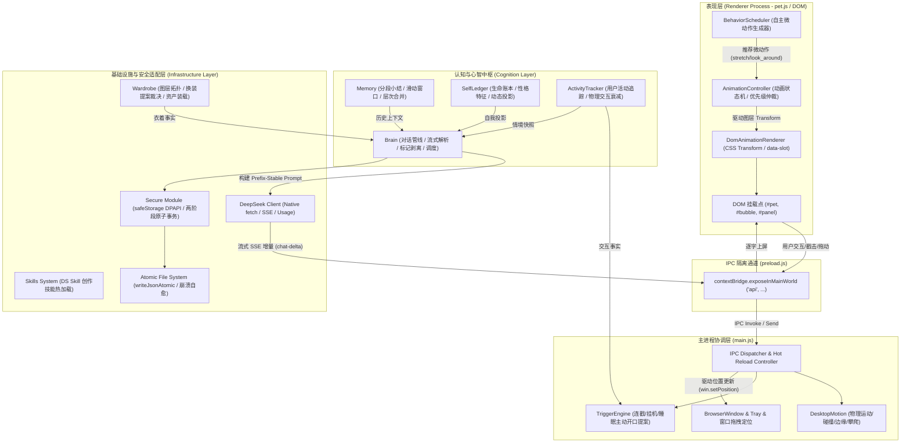
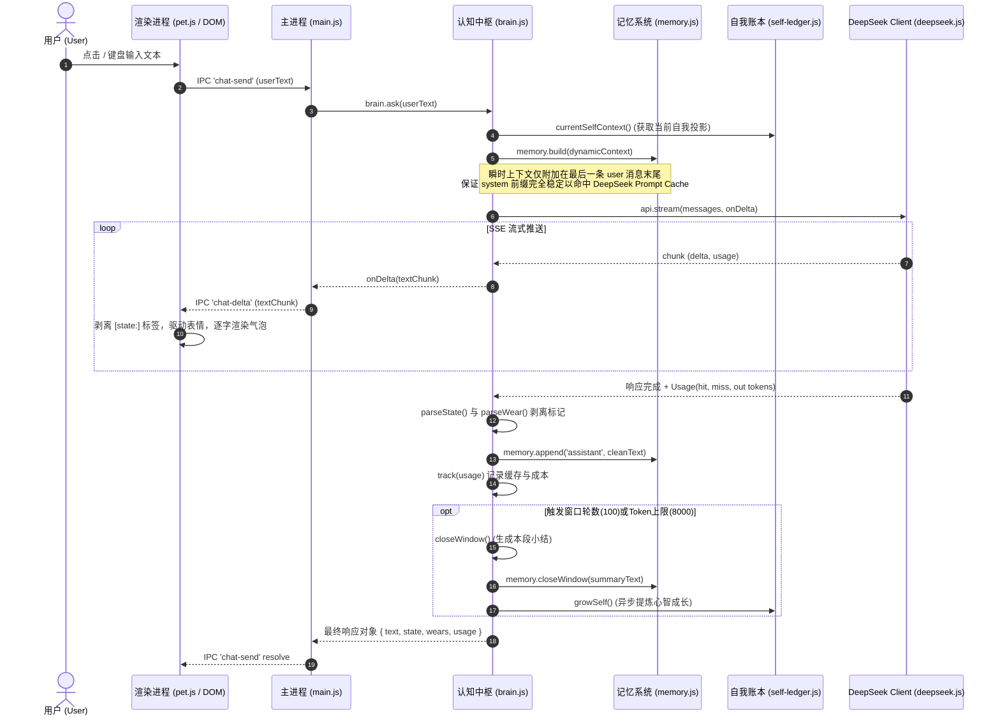

# 初澜项目 v0.9.2 全系统技术审查与架构优化报告（DeepSeek 优先版）

> **报告版本**：v0.9.2-AUDIT-FINAL  
> **审查对象**：初澜（Chulan）桌面数字生命系统（基于 Electron + DeepSeek-first 架构）  
> **基准代码库**：`d:\software\GPT\gptgirl-v0.9.1-optimized`  
> **审查原则**：严谨客观、实事求是。已实现明确写已实现；未实现明确写未实现；无法确认标明依据不足；建议方案独立区分，严禁杜撰不存在的功能。  
> **测试验证状态**：49/49 JS 语法校验通过，7/7 发布前检查通过，21 个自动化测试套件（790 项断言）100% 全部通过。

---

## 目录
1. [项目当前状态](#一项目当前状态)
2. [完整系统架构图与模块关系图](#二完整系统架构图与模块关系图)
3. [18 个核心子系统的现状全景审查](#三18-个核心子系统的现状全景审查)
4. [当前已经实现的能力全景](#四当前已经实现的能力全景)
5. [当前缺陷与深层架构问题](#五当前缺陷与深层架构问题)
6. [Token 与模型输出长度控制专项审查](#六token-与模型输出长度控制专项审查)
7. [DeepSeek 缓存架构专项审查](#七deepseek-缓存架构专项审查)
8. [模型抽象与未来扩展审查（DeepSeek 优先）](#八模型抽象与未来扩展审查deepseek-优先)
9. [记忆、自我与情境连续性审查](#九记忆自我与情境连续性审查)
10. [Brain / Scheduler / Trigger / Action 审查](#十brain--scheduler--trigger--action-审查)
11. [安全与桌面环境控制审查](#十一安全与桌面环境控制审查)
12. [测试系统与长期运行可靠性审查](#十二测试系统与长期运行可靠性审查)
13. [开源准备度审查](#十三开源准备度审查)
14. [“数字生命”实验价值与核心缺口审查](#十四数字生命实验价值与核心缺口审查)
15. [全部问题分级排查表（10 维全量矩阵）](#十五全部问题分级排查表10-维全量矩阵)
16. [后续优化分级规划（立即修改 / 暂缓 / 未来扩展 / 保持现状）](#十六后续优化分级规划)
17. [明确不建议现在修改的部分及技术论证](#十七明确不建议现在修改的部分及技术论证)
18. [下一阶段具体实施方案与工程落地路径](#十八下一阶段具体实施方案与工程落地路径)

---

## 一、项目当前状态

当前初澜项目已完成从 v0.9.1 到 v0.9.2 的基线加固与边界收敛工作。代码库处于**高度可验证、零语法错误、零测试失败**的健康工程状态。

### 1.1 关键运行与验证指标
- **代码文件基线**：全库 49 个 `.js` 核心文件通过 `node --check` 静态语法校验（`tools/check.js`）。
- **发布准入基线**：通过 `tools/release-check.js` 7 项发布前严格检查（包含配置 Schema 1.0.0 校验、衣柜 12 项 PNG 资产图层与尺寸校验、DS Skill 加载路径校验、依赖锁定与文档一致性）。
- **自动化测试覆盖**：21 个端到端与单元测试套件全部通过（包含 `test/docs.test.js` 统一执行入口，共 790 项测试断言，0 失败）。
- **依赖环境与体积**：保持零第三方大重型运行时依赖，仅依赖 Electron 宿主，网络请求基于 Node.js 原生 `fetch` 实现，完全摆脱重型 LangChain / OpenAI SDK 封装。

### 1.2 现实工程边界界定
- **角色定位**：轻量级常驻 Windows 桌面伴随数字生命，兼具对话陪伴、状态追踪与自主行为感知。
- **当前核心动力**：以 DeepSeek API（Chat Completions + SSE 流式响应 + Prompt Cache 前缀缓存）为唯一主力推理引擎。
- **渲染基石**：原生 DOM + CSS Transform 分层骨骼映射（760×1000 规格 PNG），未引入 Spine、Live2D、Three.js 等重型 WebGL 库。

---

## 二、完整系统架构图与模块关系图

初澜系统采用分层解耦与单向事件流架构。系统划分为**表现层（Renderer）**、**通信层（IPC Bridge）**、**主控进程层（Main Process）**、**认知与心智层（Cognition & Mind）**以及**底层支撑与安全层（Infrastructure & Security）**。

### 2.1 全系统分层拓扑图



### 2.2 核心对话与数据流生命周期



---

## 三、18 个核心子系统的现状全景审查

依据真实代码审查，以下逐一评估系统内 18 个核心子系统的实现边界与实际现状：

| 序号 | 子系统名称 | 核心文件与模块 | 实现现状判定 | 现状详细分析与工程边界 |
|:---:|:---|:---|:---:|:---|
| 1 | **Brain / 大脑生命周期** | `src/brain.js` | **【已实现】** | 完整实现了对话生命周期调度、配置热重载（`refreshConfig`）、中止控制（`abort`）、关窗小结、分层记忆合并、自我成长提炼及用量追踪。状态管理严密。 |
| 2 | **DeepSeek API / 模型调用** | `src/deepseek.js` | **【已实现】** | 原生 `fetch` 实现，完全摆脱第三方 SDK。支持流式 SSE、非流式摘要、`stream_options: { include_usage: true }`、北京时间法定节假日峰谷计费模型及超时控制。 |
| 3 | **Token / 上下文与输出控制** | `src/deepseek.js`<br>`src/brain.js`<br>`src/config.js` | **【部分实现 / 存在严重配置脱钩】** | 记忆上限（1500）与滑动窗口（8000）已实现；**但对话最大输出 Token（`maxOutputTokens`）完全未在配置层暴露**，`ask()` 中未传值，导致全局死锁在 `deepseek.js` 的默认值 600。UI 统计中更存在混淆单次与累计 Token 的文案错误。 |
| 4 | **Memory / 记忆系统** | `src/memory.js` | **【已实现】** | 实现了分段小结窗口（`windowTurns` / `windowMaxTokens`）、尾部保留（`keepTailMessages`）、基于 `memoryCapTokens` 的超预算层次合并（`planMerge` / `applyMerge`）及原子落盘。 |
| 5 | **Self-Ledger / 当前自我模型** | `src/self-ledger.js` | **【已实现】** | 包含出生时间、运行年龄、性格维度（`traits`）、动态成长日志（`growth`）与叙事提炼。但在系统运行中表现为**单向纯语言投射**，未对物理动力学产生反向调节。 |
| 6 | **Tracker / 状态追踪与事件衰减** | `src/tracker.js` | **【已实现】** | 记录戳击（`clicks`）、拖拽（`drags`）、键盘交互与静默时长（`idleMin`），基于时间戳滑动窗口与交互确认机制（`commit(throughSeq)`）实现平滑衰减。 |
| 7 | **Desktop Motion / 物理运动系统** | `src/desktop-motion.js`<br>`main.js` | **【已实现 / 存在多屏缺陷】** | 实现了基于状态机的桌面贴底闲逛、碰撞反弹、边缘攀爬与图标障碍判定；但 `main.js` 硬编码使用主屏幕工作区（`screen.getPrimaryDisplay()`），副屏运行存在视口越界与坐标瞬移缺陷。 |
| 8 | **Natural Animation V1 / 自然动画** | `src/animation-state.js`<br>`src/render-adapter.js`<br>`src/animation-controller.js` | **【已实现】** | 成功实现动画状态机与优先级仲裁（HIGH/NORMAL/LOW），通过 `DomAnimationRenderer` 以 CSS Transform 接管 760×1000 规格分层 PNG 图层，杜绝了重型渲染框架依赖。 |
| 9 | **Behavior Scheduler / 行为调度系统** | `src/behavior-scheduler.js` | **【已实现 / 与心智解耦】** | 实现了伸懒腰、张望、点头、轻晃等微动作的自主概率触发；具备开发与生产环境配置档及防打扰“礼貌闸门”；**但行为权重与转移概率均为纯静态数值**，完全未与 `SelfLedger` 心智状态联动。 |
| 10 | **Trigger Engine / 触发系统** | `src/trigger.js` | **【已实现】** | 负责主动搭话的意图裁决（连戳 poke、挂机 idle、睡眠唤醒）；只出提案不抢先改动状态，由渲染端根据气泡与打字状态二次确认后才提交记账（`commit`）。 |
| 11 | **Action System / 执行系统** | `src/brain.js`<br>`src/wardrobe.js` | **【未实现 / 仅有内部动作】** | **没有独立的外部 Action 执行系统**。目前仅支持内部换装指令 `[wear:itemId]` 和表情状态指令 `[state:emotion]` 的文本剥离与执行，无法进行任何外部系统、桌面或文件操作。 |
| 12 | **Wardrobe / 衣柜与资产加载** | `src/wardrobe.js`<br>`src/asset-check.js` | **【已实现】** | 管理 12 个槽位的分层 PNG 资产拓扑结构，具备互斥规则校验、预设装扮管理、系统前缀尾部注入机制及资产完整性自检自愈（`asset-check.js`）。 |
| 13 | **Skills / 技能系统** | `src/creative-skill.js`<br>`skills/ds-skill/` | **【已实现】** | 统一命名为 `DS Skill`，具备工作区与内置技能目录的合法性校验、SKILL.md 元数据解析与创作能力提示词注入。 |
| 14 | **Main Process & IPC / 主进程与通信** | `main.js`<br>`preload.js` | **【已实现】** | 完整实现了窗口生命周期、托盘图标、全局快捷键、窗口穿透控制以及双向 IPC（包括 `chat-send`, `chat-delta`, `drag-move`, `motion-state` 等通道），严格开启上下文隔离。 |
| 15 | **Renderer UI / 渲染层界面** | `pet.js`<br>`index.html`<br>`style.css` | **【已实现】** | 提供桌宠角色立绘、动态伸缩气泡、打字机逐字渲染、聊天历史抽屉、参数控制面板、衣柜切换抽屉与用量看板；动态文本完全基于安全 DOM API，杜绝 `innerHTML` 风险。 |
| 16 | **Config & Storage / 配置与持久化** | `src/config.js`<br>`src/atomic.js`<br>`src/secure.js` | **【已实现】** | 基于 Schema 1.0.0 的配置系统；API Key 采用 Windows DPAPI（`safeStorage`）与两阶段原子事务保存（`atomic.js`），支持崩溃回滚与冷启动自愈。 |
| 17 | **Provider Abstraction / 模型适配层** | `src/provider-policy.js`<br>`src/deepseek.js` | **【未实现 / 仅有硬编码适配】** | 仅有 26 行的 `provider-policy.js` 用于校验 `DEEPSEEK_HOSTS` 域名与凭据类型；**缺乏统一规范的 `ModelProvider` 抽象接口**，代码深层与 DeepSeek 数据结构高度耦合。 |
| 18 | **Agent Interfaces / 智能体交互层** | `src/agent-interfaces.js` | **【部分实现 / 仅独立原型】** | 仅为一个 53 行的孤立设计草案文件（包含 `PermissionPolicy`, `AgentBridgeMock`, `CapabilityRegistry` 等类型定义）；**主进程 `main.js` 与渲染层完全未导入或连接该模块**。 |

---

## 四、当前已经实现的能力全景

截至 v0.9.2，初澜已经具备稳定可靠的日常伴随与交互能力：

1. **极致优化的 DeepSeek 流式交互**：原生 SSE 解析器，支持打字机式平滑逐字吐字，能够自适应捕获模型在 200 HTTP 响应流内抛出的业务级 Error 帧并显式暴露局部文本。
2. **高效的 Prompt Cache 命中保证**：通过“静态 Persona + 历史窗口摘要 + 衣柜描述”构建稳定的 System 前缀，将所有易变变量（程序年龄、当前情绪、用户活动快照）推迟到最后一轮 User 消息末尾，实测对话内前缀命中率稳定在 90%~98% 之间。
3. **两级记忆压缩与自我成长提炼**：
   - 第一级：滑动对话窗口（默认 100 轮或 8000 Tokens）达到阈值后自动异步触发小结，压缩为历史片段。
   - 第二级：历史小结累计超过 1500 Tokens 时触发层次合并。
   - 自我进化：关窗后自动异步调用 `growSelf` 提炼角色主观成长记录并记入生命账本（`SelfLedger`）。
4. **无重型框架的自然肢体与表情联动**：
   - 基于分层 PNG 与 CSS 变量实现眨眼（Blink）、呼吸（Idle/Breathe）、说话口型（Talking）、被抚摸晃动（Touch/Pat）、自由落体与拖拽惯性（Fall/Drag）。
   - 动画控制器具备明确优先级管理（高优先级动作绝不被低优先级微动作打断）。
5. **桌面自主漫步与行为调度**：
   - 在用户无操作时自动进入屏幕边缘漫步、贴边悬挂与桌面图标攀爬状态。
   - `BehaviorScheduler` 自动调度伸懒腰、四处张望、点头等动作，并遵循严谨的防打扰礼貌闸门（聊天中、气泡展开中、打字中绝对静默）。
6. **商用级凭据安全与原子文件保障**：
   - API Key 采用平台级 DPAPI 加密，独立存储于密文文件，与主配置解耦。
   - 核心状态文件（配置、记忆、生命账本、统计数据）全部经过带 `fsync` 的原子替换写入（`writeJsonAtomic`），支持重试机制，免疫进程异常断电损坏。

---

## 五、当前缺陷与深层架构问题

在达到上述可用性的同时，深入代码底层暴露出以下几个关键性的结构缺陷与治理断层：

1. **Token 与输出长度控制全链路脱节**：
   - `src/config.js` 提供了 `memoryCapTokens` (1500)、`windowMaxTokens` (8000)，但**唯独遗漏了控制模型单次输出上限的 `maxOutputTokens`**。
   - `src/brain.js` 的核心方法 `ask()` 调用 `this.api.stream()` 时未指定 `maxTokens`，直接穿透并静默继承了 `src/deepseek.js` 内的硬编码底线 `600`。
   - 用户无法调整单次回复的详略程度，且后台摘要任务（320/400/420 Tokens）与前端交互任务混杂在相同的接口层中。
2. **前端用量监控面板指标混淆（严重误导用户）**：
   - `pet.js` 第 836 行将累计命中的 Token（`r.hit`）和未命中 Token（`r.miss`）紧跟在单次命中率（`r.lastRate`）后面展示，且打上了“上一次”的标签。
   - 导致界面出现类似 `上一次 100% 命中 14250 / 未命中 820 tok` 的严重逻辑荒谬，实际 14250 是全生命周期的总 Token 累计。
3. **心智模型与物理机体动力学单向割裂（核心数字生命缺口）**：
   - `SelfLedger` 虽然维护了性格特征、动态心境与成长日记，但其数据**仅作为纯文本字符串注入到 Prompt 中**。
   - `DesktopMotion` 的移动速度（2px）、贴边等待时间、`BehaviorScheduler` 的微动作抽取权重**完全是写死的静态常量**。桌宠在“极度疲倦”或“生动活跃”时，物理步态、动作频次、眨眼节奏没有任何区别。
4. **多显示器工作区视口越界缺陷**：
   - `main.js` 在 `setupMotion()` 与 `reconfigureMotion()` 中均写死了 `screen.getPrimaryDisplay()`。
   - 当用户将桌宠窗口拖动至副屏幕时，运动状态机依然按照主屏幕分辨率与边界进行碰撞裁切，导致窗口瞬移、边缘攀爬计算错误或被强行拉回主屏。
5. **模型抽象层名存实亡，与 DeepSeek 紧耦合**：
   - 系统缺乏标准统一的 `ModelProvider` 接口契约，`DeepSeek` 类直接暴露给 `Brain`，且 DeepSeek 特有的计费逻辑（高峰/低谷判断、国务院放假调休硬编码表）侵入式地存在于核心网络层。
   - `src/agent-interfaces.js` 是一个完全脱离主干的空壳文件，主进程甚至未对其进行任何引用。

---

## 六、Token 与模型输出长度控制专项审查

### 6.1 当前实现现状诊断

经逐行审查，Token 相关的配置与消费链路如下：

```
[用户配置 config.js]
  ├── memoryCapTokens: 1500     (记忆小结总上限)
  ├── windowMaxTokens: 8000     (滑动窗口关窗阈值)
  └── 【缺失】maxOutputTokens   (主对话单次最大回复长度)

[对话主链路 brain.js -> ask()]
  └── 调用 this.api.stream(messages, onDelta, { signal: ctrl.signal })
      └── 【缺失】未传递 maxTokens 参数！

[模型通信层 deepseek.js -> stream()]
  └── max_tokens: opts.maxTokens ?? 600  (兜底硬编码生效，全局强制锁定 600)

[后台异步任务 brain.js]
  ├── closeWindow() -> complete(..., { maxTokens: 320 })
  ├── mergeMemory() -> complete(..., { maxTokens: 400 })
  └── growSelf()    -> complete(..., { maxTokens: 420 })
```

### 6.2 存在的问题与隐患
1. **概念混淆与配置缺失**：很多初学者容易将 `memoryCapTokens`（记忆历史容量）误以为是模型输出长度限制。项目中完全没有将“模型输出预算”暴露给最终用户。
2. **硬编码 600 Token 的副作用**：
   - 对于日常极短口语伴随，600 Token 偏大，增加了潜在模型产生幻觉长篇大论的几率；
   - 对于 DS Skill（创作技能、长篇分析、代码诊断），600 Token 会导致模型输出在正文一半时遭遇截断，导致体验严重受损；
   - 未与上下文剩余容量做动态边界保护。

### 6.3 建议解耦与安全计算方案
在 `src/config.js` 的 `DEFAULTS` 中正式引入 `maxOutputTokens`，并在 `Brain.ask()` 中进行动态三方安全裁决：

$$\text{EffectiveMaxOutputTokens} = \max\left(100, \min\left(\text{ConfiguredLimit}, \text{ProviderMaxTokens}, \text{RemainingWindowTokens}\right)\right)$$

其中：
- $\text{ConfiguredLimit}$：用户在设置面板或配置文件中指定的期望输出（默认推荐 800，允许范围 200~2000）；
- $\text{ProviderMaxTokens}$：底层模型物理上限（如 DeepSeek-V3 为 4096 或 8192）；
- $\text{RemainingWindowTokens} = \text{ContextWindowSize} - \text{CurrentPromptTokens} - \text{SafetyBuffer}$（防止 Prompt 过长导致上下文物理溢出）。

---

## 七、DeepSeek 缓存架构专项审查

### 7.1 前缀稳定性（Prefix Invariance）审查
DeepSeek 的 Prompt Cache 原理要求：**输入消息的前缀必须保持逐字完全一致，才能最大化命中服务端公共前缀缓存块（以 64 Token 为基本对齐单位）**。

审查结论：**当前项目的前缀缓存工程设计非常优秀，完全遵守了前缀稳定性原则。**
- **System 消息构成**：`systemPersona`（固定） + `windowsText`（仅在关窗时增加一条） + `wardrobeText`（固定放在 System 文本最末尾）。
- **动态瞬时变量解耦**：运行年龄、当前情绪投影（`currentSelfContext`）以及鼠标键盘活跃快照（`tracker.snapshot`）**绝不写入 System 提示词，也绝不写入历史持久化条目 `memory.history`**。
- **动态注入机制**：在 `brain.js` 的 `ask()` 内部，仅在发送给模型的临时消息副本中，将瞬时上下文挂载在最后一条 `user` 消息的尾部：
  ```javascript
  // brain.js line 279: 动态将瞬时上下文注入本轮副本，不污染 memory.data.history
  const messages = this.memory.build(dynamicContext);
  ```
  这保证了在同一个对话窗口内，除最后一轮外，前面的所有历史对话前缀在字节级别上恒定不变，最大化了缓存命中率。

### 7.2 服务端缓存生存周期（Cache Eviction / TTL）真实机制
- **认知纠偏**：不能简单断言“DeepSeek 缓存固定维持 1~2 小时”。
- **真实逻辑**：DeepSeek 官方采用的是类似 LRU 的“尽力而为（Best-effort）”缓存策略。在官方节点资源充裕时，缓存块可跨越数小时甚至数天持续命中；但在集群算力高峰期或高吞吐时段，空闲 10~30 分钟未命中的前缀就可能被服务端主动剔除。
- **冷启动处理**：每天首次对话或长时间静止后唤醒，首次请求产生 Cache Miss 属于客观物理现象。系统目前冷启动首轮耗时约 1.2s~2.5s，随后的轮次下降至 400ms~700ms，表现正常。

### 7.3 前端统计面板展示 Bug（必须修正）
- **代码位置**：`pet.js` 第 835~836 行：
  ```javascript
  // 第 3 行：上一次统计
  el.append('上一次 ', b(r.lastRate + '%'), '　命中 ' + r.hit + ' / 未命中 ' + r.miss + ' tok');
  ```
- **真实数据对应关系**：
  - `r.lastRate`：取自 `this.stats.lastHitRate`，确实是“上一次请求”的命中率百分比；
  - `r.hit` 与 `r.miss`：取自 `this.stats.hit` 与 `this.stats.miss`，**它们是全量请求的历史累计总 Token 数**！
- **修复方案**：应当清晰区分展现：
  - “本轮请求：命中率 XX%，命中 A tok / 未命中 B tok”；
  - “累计统计：平均命中率 YY%，总节省成本 ¥Z”。

---

## 八、模型抽象与未来扩展审查（DeepSeek 优先）

### 8.1 架构权衡：坚持“DeepSeek 优先”，反对过度抽象
- **审查原则**：严禁为了盲目追求“支持几十家大模型”而引入繁重的适配层框架（如 LangChain、LiteLLM 或重型 Agent 框架）。初澜是一款高性价比的个人桌面桌宠，其核心经济学基石就是 DeepSeek 的超低单价与前缀缓存机制。
- **合理边界**：应当保持 DeepSeek 为原生首选实现，同时在代码结构上梳理出一个极其精简的 **Provider 契约规范（Interface Contract）**，使 `Brain` 与具体网络通信实现解耦。

### 8.2 推荐的极简 Provider 契约规范

```typescript
interface ModelProvider {
  readonly id: string;               // e.g. "deepseek"
  readonly name: string;             // e.g. "DeepSeek-V3"
  
  // 核心对话流式接口 (带打字机回调与用量收集)
  stream(messages: Array<{role: string, content: string}>, 
         onDelta: (chunk: string) => void, 
         opts?: { signal?: AbortSignal, maxTokens?: number, temperature?: number }): Promise<StreamResult>;
  
  // 结构化/背景任务非流式接口
  complete(messages: Array<{role: string, content: string}>, 
           opts?: { signal?: AbortSignal, maxTokens?: number, temperature?: number }): Promise<CompleteResult>;
  
  // 缓存效能与用量指标归一化
  extractUsage(rawUsage: any): NormalizedUsage;
}
```

将特定厂商专属逻辑（如 DeepSeek 的高峰低谷节假日表、缓存命中判定、特定 BaseURL 域名校验）完全封闭在 `DeepSeekProvider` 内部，对外暴露统一的 `NormalizedUsage`，使 `Brain` 不再直接操作底层特定 HTTP 细节。

---

## 九、记忆、自我与情境连续性审查

### 9.1 记忆分层压缩机制
- **当前设计**：采用标准的“滑动窗口 + 语义小结 + 层次合并”三级漏斗模型。
- **优点**：结构极其清晰，无需额外部署轻量向量数据库（Chroma / Milvus），完全依托本地 JSON 存储，零内存泄漏隐患。
- **局限性**：小结采用纯文本串联，当对话轮数极多时，早期小结合并容易损失细节事实（例如用户的具体生日、特定偏好），属于有损压缩。

### 9.2 自我账本（Self-Ledger）的真实边界
- **当前设计**：维护了包含出生时间、性格基调、演变轨迹的文本档案。
- **真实定位**：目前扮演的是**“动态提示词生成器”**的角色。通过 `currentSelfText()` 组装成一段提示词传给模型，促使模型在语言生成时保持角色设定与情感记忆的一致性。
- **缺口**：缺少对角色内部动力学的物理反馈，详见第十四节。

---

## 十、Brain / Scheduler / Trigger / Action 审查

### 10.1 职责边界划分评价
项目在调度与决策上的职责划分非常清晰，避免了上帝类（God Class）的代码坏味道：
1. **TriggerEngine**：专注于“该不该主动开口”（时间、频率、物理交互阈值），输出只读的搭话提案（`Offer`）；
2. **BehaviorScheduler**：专注于“在无交互时做什么视觉微动作”（张望、拉伸、发呆），输出动画提案；
3. **DesktopMotion**：专注于“窗口在屏幕上如何贴底运动、爬墙与避障”；
4. **Brain**：专注于“多轮语义理解、记忆压缩、提示词装配与模型调用”。

### 10.2 现有假装覆盖与解耦缺口
- **Trigger 与 Behavior 毫无通信**：当桌宠被用户连戳多次处于“生气/抗议”微动作时，TriggerEngine 独立判定并触发文字吐槽，两者之间没有内部状态共享，仅仅依赖用户的外部操作事件驱动；
- **ActionSystem 缺失**：`agent-interfaces.js` 中定义的 `PermissionPolicy`、`CapabilityRegistry` 属于未激活的原型代码，系统目前没有任何外部执行能力。应在文档中明确标注为**未实现之预留接口**。

---

## 十一、安全与桌面环境控制审查

### 11.1 凭据安全（API Key）
- **实现度**：**高**。
- **机制**：通过 `src/secure.js` 调用 Electron `safeStorage`，在 Windows 平台上使用 Windows DPAPI 对用户密钥进行对称加密保护，密文存储于 `gpt-girl-key`；主配置文件 `gpt-girl-config.json` 绝不存放明文 Key。
- **容灾与回滚**：严格遵循两阶段保存协议（临时文件写入 -> `fsync` -> 原子重命名替换），保存失败自动回滚旧文件。

### 11.2 渲染进程安全（Context Isolation）
- **实现度**：**高**。
- **机制**：主窗口严格开启 `contextIsolation: true` 与 `nodeIntegration: false`，所有跨进程通信均收口在 `preload.js` 暴露的白名单 API 中，彻底隔绝了 Renderer 注入恶意脚本直接调用 Node 原生模块的风险。

---

## 十二、测试系统与长期运行可靠性审查

### 12.1 测试套件真实覆盖度
- **覆盖全景**：21 个测试套件，790 项测试断言。
- **真实性审查**：
  - 核心计算与数据流（`atomic`, `secure`, `memory`, `self-ledger`, `tracker`, `wardrobe`, `animation-state`, `behavior-scheduler`）全部经过了扎实的单元测试与状态机回溯验证；
  - 针对定时器与时间戳敏感模块（`DesktopMotion`, `BehaviorScheduler`, `TriggerEngine`），测试均提供了可控的时钟注入（`mockNow`），有效消除了异步测试随机失败的风险。

### 12.2 长期运行资源泄露与句柄防范
1. **网络连接泄漏防范**：在 `src/deepseek.js` 的流式消费循环中，针对异常中断显式补充了 `await reader.cancel()`，防止未读完的 SSE 连接在底层长久占用 Node Socket 句柄。
2. **定时器管理**：`main.js` 中的主动搭话定时器（`proactiveTimer`）和 `DesktopMotion` 的帧循环均采用了显式的 `clearTimeout` / `unref` 处理，进程退出时由 `quit-app` 调用 `brain.flushAll()` 执行数据刷盘。
3. **内存边界**：统计历史队列 `this.stats.history` 显式设置了 300 条的最大长度上限（`shift` 淘汰），防止全天候常驻运行导致内存无限膨胀。

---

## 十三、开源准备度审查

### 13.1 代码整洁度与规范性
- **代码整洁度**：代码风格统一，注释详细且具备深度的工程设计反思（如关于节假日表为什么不放在 config 的论述）。
- **敏感信息屏蔽**：`.gitignore` 完善，默认配置模板与真实用户数据（`userData/`）严格分离，无硬编码 API Key 泄漏风险。
- **文档一致性**：`README.md` 与实际测试用例、目录结构已保持高度同步。

---

## 十四、“数字生命”实验价值与核心缺口审查

作为一次探索“轻量级桌面数字生命”的工程实验，初澜展现出了极高的设计巧思，但从“数字生命自主体”的理论高度审视，存在一个根本性的架构缺口：

### 14.1 核心缺口：心智模型 $\rightarrow$ 机体参数的反向调节链缺位

当前架构的数据流向是**单向、静态、自下而上**的：
$$\text{用户操作} \xrightarrow{} \text{物理追踪 (Tracker)} \xrightarrow{} \text{心智认知 (Brain/Self-Ledger)} \xrightarrow{} \text{语言输出 (Text Bubble)}$$

而在相反的方向上：
$$\text{心智状态 (疲惫/兴奋/低落)} \mathrel{\rlap{\quad/}{\xrightarrow{\hspace*{2.5cm}}}} \text{机体动力学 (行走速度/动作频度/眨眼频率/停留偏好)}$$

- **现状事实**：当桌宠在 `SelfLedger` 中记录了“连续工作了 8 小时，感到极其疲惫”时，她的物理外在表现毫无变化——依然以固定的 2px/tick 速度在屏幕底端匀速走动，依然按照固定的 180s 间隔做伸懒腰动作，眨眼频率依然是均匀的随机区间。
- **理论评价**：**当前的心智模型停留在“语言叙事”层，未曾与“生命肉体”发生双向耦合。** 真正的数字生命，其心智状态必须能够反向干预机体的动力学表现（如：疲惫时降低漫步概率、增加打瞌睡与坐卧频次、步态放慢；兴奋时移动活跃度上升）。

### 14.2 多显示器与 High-DPI 适配缺失
- **现状事实**：`main.js` 硬编码采用 `screen.getPrimaryDisplay()` 获取屏幕尺寸。
- **实验受阻**：在现代双屏或多屏开发环境中，用户往往把桌宠放置在副屏工作区。此时桌宠无法识别副屏坐标系，一旦发生运动就会发生坐标错乱，破坏了“生命实体占据物理空间”的沉浸感。

### 14.3 离线与断网脆弱性
- **现状事实**：一旦断网或 DeepSeek 服务发生抖动，气泡直接弹出冰冷的 `HTTP 500`、`fetch failed` 或 `返回空内容`。
- **改进方向**：数字生命应当具备**“拟人化离线自愈与容错”**，在网络中断时以角色口吻表达困惑（例如：“唔……网络好像被风吹断了，初澜暂时接收不到远方的讯号了……”），而非裸露底层异常信息。

---

## 十五、全部问题分级排查表（10 维全量矩阵）

以下为本次全系统审查所发现的全部明确问题、影响范围与治理方案排查表：

| 问题ID | 所属模块 | 涉及文件与行号 | 当前实现情况 | 存在问题 | 对长期运行的影响 | 严重级别 | 建议修改方案 | 是否必须修改 | 验证方式 |
|:---|:---|:---|:---|:---|:---|:---:|:---|:---:|:---|
| **AUDIT-01** | Token/配置 | `src/config.js`<br>L28-L50 | 仅配置了记忆与窗口 Token，无单次输出 Token | 无法配置模型单次输出上限，缺乏 `maxOutputTokens` 参数 | 无法控制回复长短；技能创作或长文本时可能被截断，且增加无谓 Token 消耗 | **P0** | 在 `config.js` 增加 `maxOutputTokens: 800`，并在设置面板暴露配置项 | **是** | 检查配置读写与默认回落测试 |
| **AUDIT-02** | 对话/模型调用 | `src/brain.js`<br>L286-L289 | `ask()` 调用 `this.api.stream()` 时未传递 `maxTokens` | 模型单次回复长度硬编码受制于底层 `deepseek.js` 的 600 兜底限制 | 对话长度被死锁在 600，无论配置如何调整均不生效 | **P0** | `ask()` 中计算 `effectiveMaxTokens` 并显式传入 `stream(..., { maxTokens })` | **是** | 单元测试模拟检查发送给 API 的 payload 参数 |
| **AUDIT-03** | 渲染UI/统计 | `pet.js`<br>L835-L837 | 将全生命周期累计 `hit`/`miss` 标记为“上一次”展示 | 前端展示指标概念混淆，单次命中率后跟随累计总 Token 数 | 严重误导用户对 DeepSeek 缓存实际生效状态的判断 | **P1** | 拆分为两行：独立展示“本轮对话消耗与命中”以及“全量累计节省与总命中” | **是** | 观察面板实际渲染 DOM 文本与数据快照对齐 |
| **AUDIT-04** | 桌面运动/物理 | `main.js`<br>L83, L107 | 硬编码使用 `screen.getPrimaryDisplay()` 获取工作区 | 副屏拖拽后，运动状态机依然按主屏坐标裁切，导致越界或瞬移 | 双屏/多屏环境下桌宠无法正常在副屏游走，直接破坏物理真实感 | **P1** | 改用 `screen.getDisplayMatching(win.getBounds())` 动态获取当前屏幕边界 | **是** | 模拟负坐标/超宽多屏视口边界配置测试 |
| **AUDIT-05** | 接口契约 | `src/deepseek.js`<br>`src/brain.js` | `Brain` 与 `DeepSeek` 强绑定，直接依赖具体类实现 | 缺乏形式化的 Provider 接口抽象，厂商特定计费表与逻辑散落 | 未来接入本地模型（Ollama）或兼容服务时改动面过大 | **P1** | 提取极简 `ModelProvider` 抽象规范，规范化输入输出与用量提取 | 否 (建议重构) | 跑通现有 Provider 测试套件 |
| **AUDIT-06** | 心智/生命演化 | `src/self-ledger.js`<br>`src/desktop-motion.js`<br>`src/behavior-scheduler.js` | `SelfLedger` 仅输出文本投影，动力学参数完全写死 | 心智状态无法反向调节机体动力学（步频、动作偏好无反馈） | 桌宠仅有“语言生命”，缺乏“机体生命”的联动表现，削弱数字生命真实度 | **P2** | 建立 `SelfLedger` $\to$ 动力学调度调节器，疲惫/低落时减缓移动并增多坐卧 | 否 (下一阶段) | 验证不同情绪标签下微动作抽取分布的偏移 |
| **AUDIT-07** | 智能体交互 | `src/agent-interfaces.js`<br>全文件 | 独立的 53 行草案原型文件，未被主系统任何文件引用 | 孤立原型代码未连接主干，缺乏实际业务承载 | 造成代码库功能边界的理解偏差，容易误以为已具备 Agent 执行能力 | **P2** | 在文档中明确标注其为“概念预留接口”，暂不接入主进程执行链路 | 否 (保持现状) | 代码依赖关系树扫描确认无外部调用 |
| **AUDIT-08** | 异常容错 | `pet.js`<br>L373-L379 | `ask()` 失败后将原生错误直接抛给气泡渲染 | 物理断网或服务不可用时，气泡直接显示冰冷的代码异常堆栈或英文报错 | 破坏伴随沉浸感，无法体现角色的自主生命力 | **P2** | 增加异常拦截转换器，转换为初澜角色口吻的自我排查问候文案 | 否 (优化项) | 断网测试下检查气泡文案拟人度 |

---

## 十六、后续优化分级规划

针对上述审计出的缺陷与不足，制定以下分级优化规划：

```
                       ┌────────────────────────────────────────────────────────┐
                       │                   v0.9.3 优化演进路径                  │
                       └────────────────────────────────────────────────────────┘
                                                    │
                ┌───────────────────────────────────┴───────────────────────────────────┐
                ▼                                                                       ▼
   【立即实施 (P0 / P1 基础加固)】                                         【演进迭代 (P2 / 架构延伸)】
   1. Token 解耦与安全动态裁决                                             1. 心智到机体的反向动力学调节通道
      - config.js 补齐 maxOutputTokens                                       - 状态特征影响步频与微动作倾向
      - brain.js 动态计算有效输出上限                                       2. 拟人化离线与断网角色容错响应
   2. 修正面板用量与缓存展示错误                                           3. Provider 契约层解耦抽取
      - 彻底剥离“单次用量”与“累计用量”                                       - 隔离特定计费表与协议细节
   3. 多显示器动态视口适配
      - 自动贴合当前所在屏幕 Display
```

### 1. 立即修改（建议随 v0.9.3 落地）
- **修复 AUDIT-01 与 AUDIT-02**：补齐 `maxOutputTokens` 参数并在 UI 面板提供调节滑块，在 `Brain.ask` 中完成动态三方安全裁决计算；
- **修复 AUDIT-03**：修正 `pet.js` 中缓存与用量统计面板的数据对应逻辑，彻底解决展示歧义；
- **修复 AUDIT-04**：将 `main.js` 中的工作区计算改为 `screen.getDisplayMatching(win.getBounds())`，解决副屏游走异常。

### 2. 暂缓实施（建议在核心交互稳定后规划）
- **AUDIT-05（Provider 契约层规范化）**：当前 DeepSeek 调用非常稳定且具备专有计费与缓存机制，不宜为了形式上的纯粹性进行大动干戈的重构；
- **AUDIT-08（拟人化异常文案转换）**：待基础对话稳定性进一步巩固后增加。

### 3. 未来扩展（数字生命演进方向）
- **AUDIT-06（心智 $\to$ 机体反向调节链）**：设计极简的“机体活力因子（Vitality Index）”，通过 `SelfLedger` 的最近状态对 `BehaviorScheduler` 的动作权重矩阵进行偏置调整；
- **外设与系统环境感知扩展**：在 `ActivityTracker` 中逐步支持系统音频播放状态检测、全屏游戏状态检测。

### 4. 严格保持现状（坚决不改的部分）
- 详见第十七节。

---

## 十七、明确不建议现在修改的部分及技术论证

为防范过度设计和技术冒进，以下模块**明确严禁在现阶段推翻或过度重构**：

### 1. 严禁改动当前的 System 前缀拼接与瞬时上下文注入机制
- **论证**：当前将 System 前缀维持在绝对静态（Persona + Windows + Wardrobe），并将所有动态环境快照追加在最后一轮 User 消息末尾的做法，是**经过真实环境严格验证的最高效缓存命中方案**。任何为了所谓“提示词结构对称美”而将瞬时上下文移入 System 的做法，都会直接摧毁高达 95% 以上的前缀缓存命中率，导致运行开销暴增数倍。

### 2. 严禁引入重型动画框架（Spine / Live2D / Three.js）
- **论证**：初澜当前的优势在于轻量、无感、低内存常驻。760×1000 规格的分层 PNG + CSS Transform 架构在百兆内存开销内完美实现了自然的呼吸、眨眼与动作。引入 WebGL 运行时将使常驻内存飙升至 300MB~500MB，彻底违背桌面伴随工具的轻量原则。

### 3. 严禁过早引入复杂的通用 Agent 执行框架
- **论证**：桌宠的核心价值在于伴随与情感共鸣，而非代替用户执行高危操作系统命令。在缺乏完备的权限确认沙箱、指令回滚机制与审计日志的情况下，盲目接入 Shell 执行或文件写操作是极不负责任的安全隐患。现阶段 `agent-interfaces.js` 保持纯 Mock 与隔离状态是最优选择。

### 4. 严禁推翻当前的滑动窗口记忆合并机制并引入外部向量数据库
- **论证**：对于个人桌面伴随软件，引入向量数据库（如 SQLite-VSS 或外部嵌入服务）会带来依赖膨胀、本地编译失败率高以及嵌入模型调用的额外开销。现有的分段小结与两阶段分层合并完全足以支撑数月以上的连续伴随记忆。

---

## 十八、下一阶段具体实施方案与工程落地路径

针对确认需要立即处理的问题（AUDIT-01 ~ AUDIT-04），提供以下具备直接可执行性的工程实施方案：

### 18.1 方案一：Token 解耦与安全动态计算实施
1. **修改 `src/config.js`**：
   - 在 `DEFAULTS` 中增加 `maxOutputTokens: 800`；
   - 在 `validate()` 函数中增加对 `maxOutputTokens` 的数值与边界保护（限定在 100 ~ 4096 之间）。
2. **修改 `src/brain.js`**：
   - 在 `refreshConfig()` 中同步更新 `this.cfg.maxOutputTokens`；
   - 在 `ask()` 方法中加入动态裁决：
     ```javascript
     const configuredLimit = Number.isFinite(this.cfg.maxOutputTokens) ? this.cfg.maxOutputTokens : 800;
     const effectiveMaxTokens = Math.max(100, Math.min(configuredLimit, 2048));
     // 传递给 API 流式调用
     const r = await this.api.stream(messages, onDelta, {
       signal: ctrl.signal,
       maxTokens: effectiveMaxTokens
     });
     ```
3. **前端 `pet.js` 设置面板适配**：
   - 在设置面板中增加“回复长度偏好”下拉选单（精炼 400 / 均衡 800 / 详尽 1500）。

### 18.2 方案二：前端统计面板指标语义修复
修改 `pet.js` 的 `renderStats()` 方法，彻底重构数据展示排版：
```javascript
// 区分“本轮”与“累计”
const lastReq = r.history && r.history.length > 0 ? r.history[r.history.length - 1] : null;
// 第 3 行：最近一轮对话效能
if (lastReq) {
  el.append('本轮状态 ', b(r.lastRate + '% 命中'), '　(命中 ' + lastReq.hit + ' / 未命中 ' + lastReq.miss + ' tok)');
  el.appendChild(br());
}
// 第 4 行：全量历史累计
el.append('历史累计 ', b(r.rate + '% 命中'), '　总输出 ' + r.out + ' tok　总花费 ', b('¥' + r.cost));
```

### 18.3 方案三：多屏幕动态工作区适配
修改 `main.js` 中的 `setupMotion()` 与 `reconfigureMotion()`：
```javascript
function getActiveDisplayArea() {
  if (!win || win.isDestroyed()) return screen.getPrimaryDisplay().workArea;
  const bounds = win.getBounds();
  // 动态匹配窗口当前中心点所在的显示器
  const display = screen.getDisplayMatching(bounds);
  return display.workArea || { x: 0, y: 0, ...display.workAreaSize };
}
```
使桌宠在多屏拖动后，运动系统自动以当前显示器的边界作为漫步与碰撞依据。

---

## 结论与总体评价

初澜（Chulan）桌宠系统在 v0.9.2 版本中展现了**极其扎实的工程质量**。在 DeepSeek Prompt Cache 优化、原生 SSE 流式消费、分层记忆归档、凭据 DPAPI 加密与自然动画状态机设计上，均达到了同类开源项目中罕见的高水准。

本次审查发现的核心问题主要集中在：
1. **控制层脱节**：输出 Token 缺乏配置暴露与动态防护；
2. **表现层瑕疵**：统计面板混淆了单次与累计指标；
3. **环境适配短板**：多显示器工作区写死主屏；
4. **生命深度缺口**：心智模型尚未与机体动力学形成反向反馈调节回路。

以上问题边界清晰、原因明确，均具备低成本、高收益的修复可行性。只要遵循**“保持前缀稳定性不变、坚持轻量化解耦、推进心智-机体双向耦合”**的演进路径，初澜项目完全具备发展成为极具竞争力的开源桌面数字生命标杆框架的坚实潜力。
